# Terrain smoothing on airfields: a greenfield design (TC3D-194)

A design for removing Cesium World Terrain (CWT) noise from airport surfaces while keeping their real slope, drawn up without reading the app's current terrain flattening, so the two can be compared. The spike that backs it is on branch `spike-terrain-greenfield` under `spikes/terrain-smoothing/`.

## 1. The problem, measured

### Method

`spikes/terrain-smoothing/measure.js`, run inside the dev app against a fresh CWT provider (ion asset 1) with the app's own terrain flattening out of the path, samples with `sampleTerrainMostDetailed`: every runway centreline at 5 m spacing, cross-sections every 200 m out to ±150 m, and a 20 m grid over the paved area plus 500 m.

It also reads the deepest available tile level and counts the TIN vertices CWT has over the paved area. Heights are converted to MSL with EGM96. `analyze.py` turns the samples into the tables below.

Definitions: **raw RMS by wavelength** is the RMS of the linearly detrended centreline profile after band-pass filtering, so a real constant grade contributes nothing and a real vertical curve sits in the >1000 m band. **Max 50 m slope** is the steepest slope over any 50 m of centreline, which is what a taxiing aircraft pitches to. **Min radius** is the smallest radius of curvature from second differences over 100 m.

**Cross P2P** is the peak-to-peak residual across the runway width after removing a straight crossfall. Published Δh is OurAirports' threshold elevations (whole feet), far end minus near end.

### Results per runway (raw CWT)

| Airport | Runway | Length m | CWT TIN spacing m | Raw P2P m | Published Δh m | Raw RMS by λ: 100–300 / 300–1000 / >1000 m | Raw max 50 m slope % | Raw min radius km | Raw cross P2P m | Verdict |
|---|---|---|---|---|---|---|---|---|---|---|
| YMML | 09/27 | 2297 | 35 | 10.0 | +3.7 | 1.04 / 0.94 / 1.65 | 10.1 | 1 | 1.3 | noise |
| YMML | 16/34 | 3667 | 35 | 36.2 | −31.1 | 1.05 / 1.53 / 0.50 | 13.1 | 1 | 1.5 | noise on a real 0.85% grade |
| YSCB | 12/30 | 1669 | 42 | 16.1 | +11.3 | 1.03 / 2.00 / 0.69 | 10.3 | 1 | 0.6 | noise on a real 0.68% grade |
| YSCB | 17/35 | 3292 | 42 | 13.1 | −1.5 | 1.05 / 1.21 / 1.95 | 14.7 | 1 | 1.0 | noise |
| YMLT | 14L/32R | 731 | 47 | 6.5 | +3.0 | 0.62 / 1.05 / – | 5.0 | 2 | 0.0 | noise on a real 0.4% grade |
| YMLT | 14R/32L | 1990 | 47 | 8.9 | −3.7 | 0.98 / 0.74 / 0.66 | 14.8 | 1 | 0.9 | noise |
| YMLT | 18/36 | 713 | 47 | 7.8 | n/a | 0.71 / 0.82 / – | 8.4 | 2 | 0.1 | noise (grass) |
| YBBN | 01L/19R | 3302 | 23 | 5.0 | n/a | 0.26 / 0.56 / 0.53 | 5.5 | 2 | 0.5 | outdated: the runway opened in 2020, the DEM predates it |
| YBBN | 01R/19L | 3555 | 23 | 0.5 | −0.3 | 0.03 / 0.04 / 0.11 | 0.6 | 20 | 0.3 | clean |
| YSSY | 07/25 | 2498 | 29 | 2.6 | +1.2 | 0.04 / 0.20 / 0.57 | 0.9 | 14 | 0.2 | clean |
| YSSY | 16L/34R | 2457 | 29 | 0.9 | −0.9 | 0.03 / 0.07 / 0.07 | 0.4 | 42 | 0.4 | clean |
| YSSY | 16R/34L | 3973 | 29 | 4.7 | +1.8 | 0.06 / 0.15 / 1.11 | 1.2 | 12 | 0.1 | clean, real profile |
| YPPH | 03/21 | 3435 | 28 | 7.0 | −7.3 | 0.03 / 0.09 / 0.70 | 0.8 | 20 | 0.3 | clean, real 0.21% grade |
| YPPH | 06/24 | 2198 | 28 | 1.9 | 0.0 | 0.06 / 0.16 / 0.47 | 0.5 | 30 | 0.2 | clean |
| YBCS | 15/33 | 3215 | 18 | 0.9 | −0.6 | 0.06 / 0.08 / 0.16 | 1.0 | 9 | 0.2 | clean |
| YMHB | 12/30 | 2223 | 28 | 0.5 | +0.3 | 0.03 / 0.04 / 0.12 | 0.3 | 29 | 0.2 | clean |
| KSFO | 01L/19R | 2286 | 18 | 1.0 | −0.3 | 0.06 / 0.13 / 0.17 | 0.7 | 16 | 0.4 | clean |
| KSFO | 01R/19L | 2644 | 18 | 0.6 | −0.6 | 0.03 / 0.06 / 0.10 | 0.6 | 23 | 0.4 | clean |
| KSFO | 10L/28R | 3596 | 18 | 2.4 | +2.4 | 0.02 / 0.06 / 0.12 | 0.6 | 17 | 0.5 | clean |
| KSFO | 10R/28L | 3280 | 18 | 2.2 | +2.1 | 0.04 / 0.11 / 0.28 | 0.9 | 24 | 0.4 | clean |
| KOAK | 10L/28R | 1625 | 14 | 0.4 | 0.0 | 0.02 / 0.05 / 0.03 | 0.2 | 43 | 0.3 | clean |
| KOAK | 10R/28L | 1899 | 14 | 0.4 | 0.0 | 0.03 / 0.03 / 0.03 | 0.5 | 23 | 0.3 | clean |
| KOAK | 12/30 | 3081 | 14 | 0.7 | +0.3 | 0.03 / 0.05 / 0.10 | 0.5 | 34 | 0.3 | clean |
| KOAK | 15/33 | 1025 | 14 | 0.8 | +0.6 | 0.04 / 0.03 / 0.02 | 0.4 | 29 | 0.1 | clean |

The <100 m band is under 0.6 m RMS everywhere (0.11–0.56 m at the bad-data runways, ≤ 0.05 m at the clean ones) and is left out above for width. All fields come from CWT level 15 (Australia) or 16 (US). The full output, with the dominant noise wavelength and the paved-area statistics, comes from `uv run spikes/terrain-smoothing/analyze.py .tmp/terrain-measure <png dir> auto`.

### What the numbers say

- **Two populations, not one.** CWT's Australian coverage is Geoscience Australia's 5 m LiDAR DEM "in populated areas and coasts" (Cesium's asset page); where that runs out, CWT falls back to 30–90 m data.

  YMML, YSCB and YMLT sit in the fallback: their level-15 tiles mostly carry 100–300 vertices, a mean vertex spacing of 35–47 m over the paved area against 14–29 m at the other fields, and their runways show 1–2 m RMS of noise at 100–1 000 m wavelengths, 7–12 m peak to peak, and 50 m slopes of 5–15% where Annex 14 allows 1.25%.

  YSSY, YPPH, YBCS, YMHB and both US controls are clean: under 0.2 m RMS below 1 km wavelength and 50 m slopes ≤ 1.2%, i.e. the data is already a plausible runway.
- **The noise wavelength is a few hundred metres** (dominant wavelength of raw − S: YMML 290–370 m, YSCB 560–1 100 m, YMLT 220–735 m), with substantial power out to 1 km. That is the same band as a short vertical curve, so no fixed low-pass separates them; the physics of §2 does.
- **Real gradients are large and must survive.** YMML 16/34 falls 31.1 m (0.85%) from threshold 16 to 34 and YSCB 12/30 climbs 11.3 m (0.68%); YPPH 03/21 falls 7.3 m on clean data. A flattening that planes the airfield to one height is out by 15 m or more at a runway end.
- **Bad data is not only the fallback DEM**: YBBN 01L/19R, built 2012–2020 on reclaimed swamp, has 5 m of relief and 5.5% local slopes in an otherwise clean LiDAR field, because the DEM predates the runway.
- **Smoothing clean data does harm, and one cutoff does not fit all.** A 1D 800 m smoothing of the centrelines still left YMML with radii of 9–16 km. A 2D fit at 800 m over every cell of the grid let the hill west of YBCS lift its runway surface by up to 3 m and smeared the runway embankment into the surrounding swamp.

  Fitted to pavement only but at a fixed 1.5 km, it still moved the clean fields' runways by 0.13–1.4 m RMS (YBCS worst). The design therefore fits only to pavement and decides per airport whether to smooth and how hard (§4.1 steps 4 and 5).

## 2. What the surface should be

The physical limits come from ICAO Annex 14 (Vol. I, 3.1 and 3.9), and they are what separates noise from real slope:

| Surface | Longitudinal slope | Change of slope | Transverse slope |
|---|---|---|---|
| Runway, code 3 and 4 | ≤ 1% overall, ≤ 1.25% locally (0.8% in the first and last quarter, code 4) | ≤ 1.5% between slopes; transition ≤ 0.1% per 30 m, i.e. radius of curvature ≥ 30 000 m (code 4) or 15 000 m (code 3) | 1–1.5% crown or one-way |
| Runway strip, graded part (75 m each side of centreline) | as the runway | as gentle as practicable | ≤ 2.5% |
| Taxiway | ≤ 1.5% | ≤ 1% per 30 m (radius ≥ 3 000 m) | ≤ 1.5% |
| Apron | ≤ 1% | – | – |

A bump of height `d` over a length `L` needs a radius of curvature of about `L² / 8d`: a 1 m bump over 300 m needs 11 km, three times sharper than any code 4 runway is built. So on a runway anything with a wavelength under roughly a kilometre and an amplitude over a few decimetres is data noise, while a grade of up to about 1% running end to end, and gentle vertical curves, are real and must survive. The filter below is chosen to cut exactly there.

## 3. Approaches

Two questions are separate and are answered separately: **where the corrected surface comes from** (the fit) and **how it reaches the screen and the aircraft** (the delivery).

### 3.1 Delivery

| # | Approach | Noise out, slope kept | Seams and LODs | Aircraft match what is drawn | Cost | Remote browsers and iPads | Cesium private API |
|---|---|---|---|---|---|---|---|
| A | Wrapping provider that edits the heights of CWT's own quantized-mesh vertices in place | Only at the vertices CWT happens to have; a long triangle across the blend band cannot bend, so the band shows folds and steps | Each LOD's TIN is different, so each LOD gets a different approximation of the surface; normals and skirts must be rebuilt | Only where the TIN is dense; elsewhere the drawn plane between sparse vertices departs from the fit | Cheap per tile | Same as desktop | Reads `_quantizedVertices`, `_indices`, `_minimumHeight` (private), or re-fetches and decodes raw tiles itself |
| B | **Wrapping provider that resamples only the tiles touching the airfield into a heightmap** whose heights are `(1 − w)·raw + w·S` (recommended) | Whatever the fit gives; inside the airfield the mesh is the fit itself | Inside the airfield every LOD from the minimum level up has exactly S at its vertices; the blend band is continuous; tiles outside pass through untouched | S is smooth, so the 65 × 65 grid's linear interpolation of it is within millimetres of S, at every LOD | One `interpolateHeight` per grid vertex outside the full-weight core, per resampled tile, once per tile load | Same code runs in the browser; S is built per client in a worker | None: `requestTileGeometry`, `TerrainData.interpolateHeight`, `isChildAvailable`, `HeightmapTerrainData` |
| C | `CustomHeightmapTerrainProvider` for the whole globe (or the airport area), its callback sampling CWT | As B | Every tile is a heightmap, so the TIN's detail, water mask and availability are lost everywhere, not only at the airfield | As B | Every tile on the globe resampled | Same | None, but the callback needs CWT data, so it becomes B with more work |
| D | Clip the globe around the airfield (`ClippingPolygonCollection`) and draw the airfield as its own mesh | As the fit | A hard edge between clipped terrain and the mesh: walls or gaps wherever they disagree, and no LOD on the mesh | Exact against the mesh | Moderate | Same | None, but imagery cannot be draped on a custom primitive: the mesh needs its own imagery fetch and lighting, which is a second renderer |
| E | Leave the terrain alone and clamp only aircraft (to raw terrain or to S) | Clamped to raw: aircraft ride every bump. Clamped to S: the ground still looks wrong | – | No: aircraft float or sink by the noise amplitude wherever S and the drawn terrain differ | Cheapest | Same | None |
| F | Offline local DEM per airport (Geoscience Australia ELVIS LiDAR, USGS 3DEP) blended in as a provider | Authoritative, as good as the survey | A datum seam with CWT (AHD or NAVD88 to ellipsoid), handled by the same blend as B | As B | A data pipeline per airport and hosting; coverage is patchy outside Australia, the US and Europe | Tiles served by the host | None |

### 3.2 The fit

| # | Fit | Real slope | Noise | Junctions | Cost |
|---|---|---|---|---|---|
| 1 | One plane per runway | Kept only if the runway is straight-graded; vertical curves and humps are flattened away | Removed | Planes of crossing runways disagree at the intersection by up to the noise amplitude, and taxiways have no model | Trivial |
| 2 | Per-runway longitudinal profile (smoothing spline along the centreline) plus a crossfall | Kept, curves included | Removed along the runway | Same junction problem as 1, and taxiways and aprons still need a separate model that must meet the runways | Small |
| 3 | Gaussian (or local-linear) low-pass of the whole airfield | Local-linear keeps planes; a vertical curve of radius `ρ` is biased by about `σ²/2ρ` | Only a soft cut-off, so getting the noise out costs real shape | One field, so junctions agree | Small |
| 4 | **Robust penalised least squares over the whole airfield, fitted to pavement only, anchored to published threshold heights, with the cut-off chosen per airport** (thin-plate penalty on the Laplacian, in the spirit of Garcia 2010's DCT smoother), recommended | Planes and constant-curvature surfaces are in the penalty's null space and pass unchanged; the published threshold height differences pin each runway's end-to-end grade | The filter `1 / (1 + (L f)⁴)` has a much steeper cut-off than a Gaussian; bisquare reweighting removes spikes (buildings, trees, bad posts) | One field, so runways, taxiways, aprons and infields agree | O(N log N) per iteration; 3.1 s for one 256 × 256 fit on the browser main thread in the spike |

A fit over every cell of the grid (the first version tried) fails at YBCS, where the hill west of the runway lifted the fitted runway surface by up to 3 m; fitting to pavement only (weight 1 on paved cells, 0.02 elsewhere) removes that, at the cost of needing a conjugate-gradient solver instead of a plain DCT filter.

## 4. Recommendation: one airfield surface, delivered by a resampling terrain provider (B + 4)

### 4.1 Data flow

1. **Airport selected** → `AirfieldSurfaceService.build(icao)` runs in a Web Worker:
   1. **Extent.** The paved polygons (apt.dat pavements) and the runway rectangles (OurAirports ends and width) give the paved bounding box.

      The grid covers it plus the blend band (300 m) plus 1 000 m of padding, which keeps the DCT's reflective edge bias out of every cell with `w > 0` (measured on a synthetic field whose slope reaches 8.5% at the grid edge: 13 m of error within 200 m of the edge, 1.6 m at 200–500 m, 0.9 m at 500–1 000 m, 0.06 m beyond). The grid is square-celled and a power of two per axis, at 20 m cells or coarser on large fields (256 × 256 covers 5 km at 20 m, or 7.7 km at 30 m).
   2. **Raw heights `H`.** CWT at its most detailed level at every grid node. The worker fetches the leaf tiles covering the grid (a few dozen at most) and rasterises each tile's TIN once, which is O(cells + triangles); in the spike, `sampleTerrainMostDetailed` stands in for this.
   3. **Masks.** `paved`: the apt.dat pavement polygons plus each runway's rectangle at its published width. `core`: paved plus the runway strips (±75 m from the centreline, 60 m past each end), closed by 250 m (dilate, then erode, with an exact distance transform) so the infields between runways and taxiways join it. Blend weight `w = 1 − smoothstep(d / 300 m)`, `d` the distance outside the core.
   4. **Decide whether to smooth.** Sample the raw grid along every runway centreline at 5 m. If every runway already has a smallest radius of curvature (over 100 m) of at least 7 500 m and no 50 m slope over 1.5%, the data is a plausible runway: **leave the airport raw** (cutoff 0, no provider change at all). Raw data is not held to the code 4 radius here: the clean fields measure 9–43 km over 100 m, small real or survey relief that is not worth a fit, while the bad fields measure 1–2 km.
   5. **Fit `S`** otherwise, for cutoffs `L` = 300, 500, 800, 1 200, 1 800, 2 500 m in turn, keeping the first whose `S` meets Annex 14 on every runway: radius ≥ 30 000 m (runways ≥ 1 800 m), 15 000 m (≥ 1 200 m) or 7 500 m (shorter), and no 50 m slope over 1.5%. Each fit:
      - removes the pavement-weighted best-fit plane (it keeps the DCT's reflective edge from turning a regional slope into a kink, and is added back at the end);
      - minimises `Σ wᵢ (Sᵢ − Hᵢ)² + p ‖∇²S‖² + μ Σ (S(he) − S(le) − Δh_pub)²` with `p = (L / 2π)⁴`, data weight `wᵢ` = 1 on paved cells and 0.02 elsewhere, and one term per runway that lists both threshold elevations (`μ` = 2 000, bilinear stencils at the two thresholds), so the end-to-end grade comes from the published survey and not from the noisy DEM, while the absolute level stays CWT's, consistent with the surrounding terrain and immune to AHD/EGM96 datum offsets;
      - solves it by conjugate gradients, preconditioned by `(c + p Λ²)⁻¹` applied in the DCT domain (`Λ` the Laplacian's eigenvalues, `c` the mean data weight), to a relative residual of 10⁻⁶;
      - reweights with Tukey's bisquare (4.685 × MAD of the paved residuals) three times, warm-starting each solve.
   6. **Result** `{ grid, S, w, cutoff, influence rectangle }`, about 0.5 MB as Float32 at 256 × 256, kept for the session and cached per ICAO. An airport left raw has no result and no wrapper.
2. **Rendering.** `AirfieldTerrainProvider` wraps the CWT provider and replaces `viewer.terrainProvider`. It delegates availability, tiling scheme, credits and geometric error.

   In `requestTileGeometry`, a tile at level ≥ 11 whose rectangle meets the influence rectangle is fetched from CWT and resampled to a 65 × 65 `HeightmapTerrainData` with heights `(1 − w)·H_tile + w·S`, where `H_tile` is `interpolateHeight` on that tile's own CWT data (skipped where `w = 1`). Every other tile passes through unchanged.

   Child availability comes from the source tile's `isChildAvailable`, so tiles past CWT's deepest level are upsampled from the corrected parent and keep S.
3. **Aircraft.** `groundHeight(lat, lon)` returns S bilinearly wherever `w = 1` (synchronous, no tile needed, identical on every LOD), and otherwise falls back to the existing terrain query against the wrapped provider, which now returns the blended surface. Everything else that samples terrain (tower placement, camera clamping) goes through the provider and sees the same surface.

### 4.2 Why this one

- **Clean data is left alone.** Six of the ten airports (YSSY, YPPH, YBCS, YMHB, KSFO, KOAK) pass the raw test and are not touched; the problem in §1 is a data-source problem, and the design only acts where the data is bad.
- **Real slope survives by construction.** Planes and constant-curvature vertical curves are in the null space of the thin-plate penalty, so a 1% runway and a 30 km vertical curve pass with no bias in the interior, and the threshold anchors fix the end-to-end grade to the published one. Without the anchors the fit's end-to-end height was off by up to 3.4 m (YMML 16/34: −34.5 m against −31.1 m published; YMLT 14R/32L: −0.8 m against −3.7 m), because the noise reaches past 1 km.
- **The cut-off is chosen by physics, not tuned.** The ladder stops at the first `L` whose runways meet Annex 14; on this data that is 800 m at YMML, YSCB and YMLT and 500 m at YBBN.
- **One field** means runway–runway and runway–taxiway junctions agree, the infields are graded like the strips they are, and there is no per-surface bookkeeping.
- **LODs agree inside the airfield.** At every level from 11 up, the mesh vertices sit on S, so a far runway at level 12 and a near one at level 16 differ only by the linear interpolation of a smooth surface (millimetres). Aircraft standing on S match whatever LOD is drawn.
- **Seams** are confined to the blend band, where the transition is continuous, and to tile edges outside the influence rectangle, where both sides are raw CWT. Skirts cover the residual LOD cracks as they do today.
- **No private Cesium API.** The only cost of that is no vertex normals on resampled tiles, so the wrapper reports `hasVertexNormals = false`; the app creates CWT with `Terrain.fromWorldTerrain()`, which does not request normals, so nothing is lost.
- **Remote browsers and iPads** run the same worker and provider. The fit is deterministic given the same CWT tiles, so every device draws the same surface. Measured in the spike on this PC, on the main thread: 0.6 s to sample the 256 × 256 grid, 0.8 s for the masks, 3.1 s for one fit (163 CG iterations in all), 12.2 s for the ladder at YMML (300, 500, 800 m), and about 10 ms per resampled tile (51 tiles for the tower view).

  Production needs the worker, plus a cheaper ladder: warm-start each cutoff from the previous solution and bisect, or predict `L` from the raw 100–1 000 m band RMS. An iPad should be budgeted at 3–5× these figures, off the main thread; the raw terrain shows until the surface is ready.
- **Alternative for remote clients**: the host computes S once and serves it from the 8765 server (`/api/airfield-surface/{icao}`, Float32 grid plus metadata), so iPads only resample tiles. That is optional; the per-client path works without it.

### 4.3 Open points

- **Runways absent from OurAirports or without both elevations** (YBBN 01L/19R, YMLT 18/36 here) get no anchor and take the DEM's grade after smoothing. Their threshold elevations would have to come from AIP aerodrome charts, for example through a small override table; X-Plane's apt.dat runway rows carry no elevations.
- **The blend band crosses whatever lies next to the airfield**: at KOAK it would ramp the bay beside runway 12/30 up to the runway (KOAK is left raw, so it does not happen there). A water mask or the coastline, when present, should cap `w` to 0.
- **A smoothed airport is smoothed everywhere on its paved area**, including a clean runway beside a bad one (YBBN 01R/19L moves by 0.24 m RMS). A per-runway `w` is possible but would bring back the junction problem; 0.24 m RMS is unlikely to be visible from a tower.
- **Installing the wrapper at runtime lifted the tower camera by 169 m** in the spike (187.4 m to 356.5 m ellipsoidal at YMML), both times it was installed; swapping back to plain CWT did not undo it, Shift+Home did, and with the wrapper still installed the camera then stayed at 187.4 m.

  The ground under the tower is 118.32 m raw and 118.37 m through the wrapper, so the surface is not the cause; it is how the app reacts to a provider change, which this design did not read. Integration must install the provider before the camera places itself, or re-place it after.

## 5. Verification

1. **Unit, offline** (Vitest, no Cesium ion): the DCT pair against the naive sum; the smoother on a synthetic field with a 1% plane, a 30 km vertical curve, 2 m of short-wavelength noise and spike outliers, asserting the interior error is under 0.05 m; the weight field on a real airport's polygons (core and band areas).

   The provider is checked against a fake source, asserting that a tile inside the core equals S, a tile outside equals the source and a tile below the minimum level passes through. The spike's `check-dct.mjs` and `check-provider.mjs` are these tests in Node form.
2. **Measured, in the app** (the method of §1, rerun through the wrapped provider): on each smoothed runway the 50 m slope stays ≤ 1.5%, the smallest radius above its Annex 14 limit, and the end-to-end height difference within 0.3 m of the published one where both thresholds are listed; on each airport the raw test passes, the provider is not installed.
3. **Consistency**: `sampleTerrainMostDetailed(wrapped)` and `globe.getHeight` on the drawn LOD against `groundHeight()` at points across the core, all within 0.05 m.
4. **Visual**: the same tower-cab camera before and after, with 1 m elevation contours on the globe; noise shows as contour islands and kinks, real slope as evenly spaced straight contours.
5. **Regression set**: YMML, YSSY, YBBN, YPPH, YBCS, YMHB, YSCB, YMLT for real slope and bad data; KSFO and KOAK as flat controls, where the change must stay under the noise.

## 6. The spike

Files in `spikes/terrain-smoothing/`, injected at runtime into the dev app (nothing in `src/` changes):

| File | What it does |
|---|---|
| `extract-runways.mjs` | Builds `airports.json` / `airports.js`: runways (OurAirports), paved polygons (apt.dat), EGM96 geoid height per airport |
| `measure.js` | `__tsSpike.measure(icao)`: samples a fresh CWT provider along and across every runway and on a 20 m grid; returns JSON |
| `analyze.py` | Turns the samples into the tables in §1 and the profile and map PNGs |
| `airfield-surface.js` | The recommended design: `buildSurface`, `AirfieldTerrainProvider`, `install(icao)`, `useRaw()`, plus `contours()` and `consistency()` for captures and checks |
| `check-dct.mjs`, `check-provider.mjs` | Offline checks of the DCT, the smoother and the provider's tile resampling |

Injecting it (Playwright `browser_run_code_unsafe` against the dev app):

```js
async (page) => {
  for (const f of ['airports.js', 'measure.js', 'airfield-surface.js'])
    await page.addScriptTag({ path: `X:/dev/towercab-3d.wt/terrain-greenfield/towercab-3d/spikes/terrain-smoothing/${f}` })
}
```

then `await __tsSpike.install('YMML')` swaps in the wrapped provider and `await __tsSpike.useRaw()` swaps raw CWT back.

`install('YMML', { cutoffM: 'auto' })` runs the ladder of §4.1; `{ cutoffM: 800 }` fits one cutoff.

### Results at YMML

The app's "Flatten Airport Runways" setting was off for every capture and measurement, and restored afterwards; sampling YMML through a fresh CWT provider gave identical heights with the setting on and off. The camera is the app's tower position at YMML (187.4 m ellipsoidal), heading 200°, pitch −6°, FOV 60°, fixed noon light; the yellow lines are 1 m elevation contours.

| Raw CWT | Airfield surface (cutoff 800 m, chosen by the ladder) |
|---|---|
| 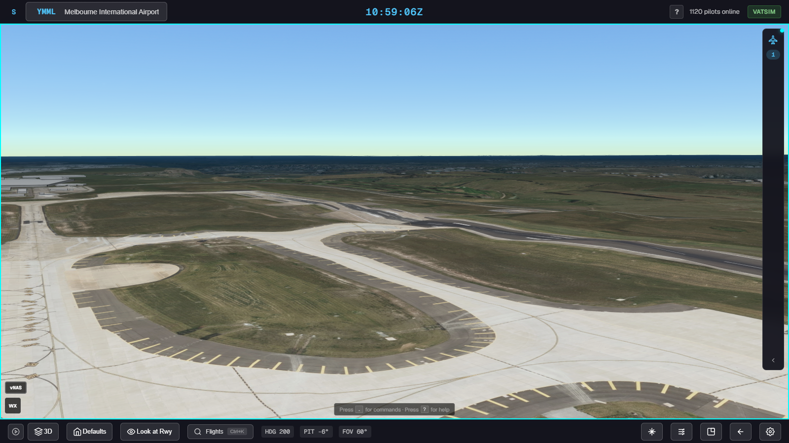 | 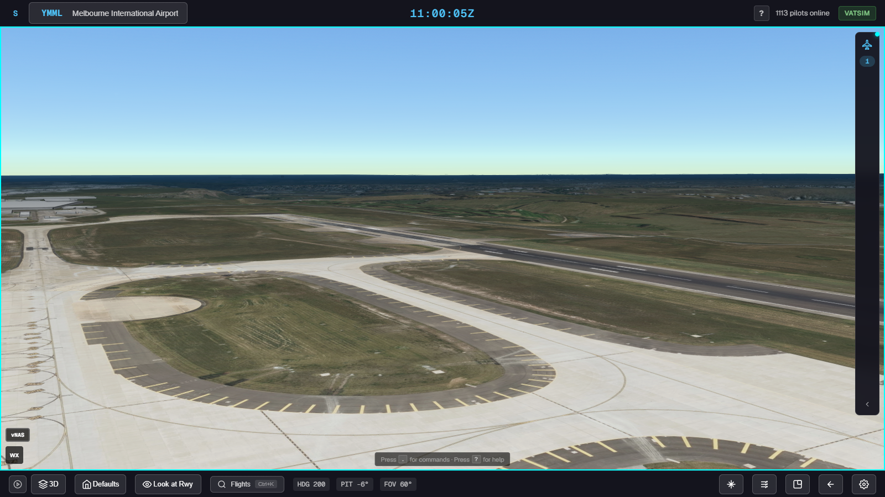 |
| 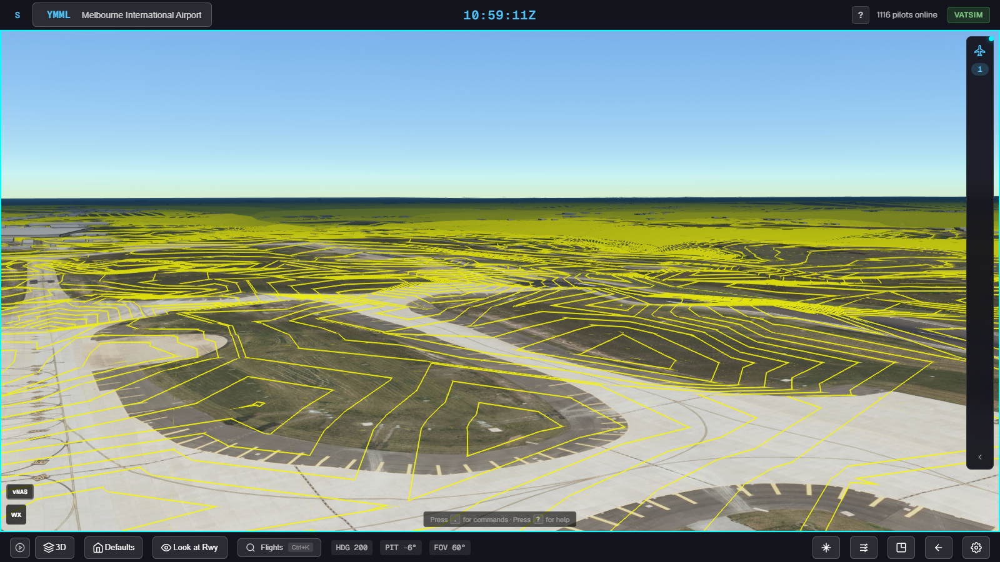 | 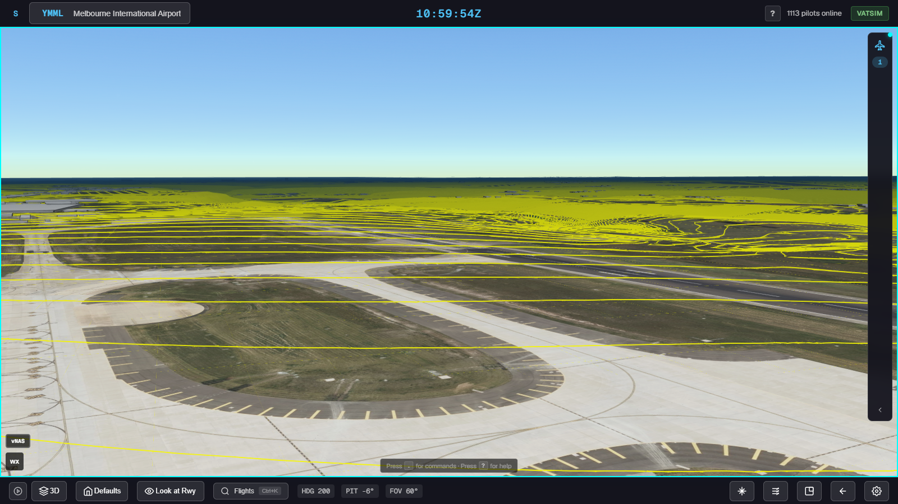 |

Raw, runway 16/34 visibly kinks in the middle distance and the 1 m contours form islands, zigzags and closed loops all over the pavement. Smoothed, the runway is straight, the contours over the airfield are evenly spaced parallel lines (the real 0.85% fall of runway 16/34 to the south) and the transition to the raw terrain beyond happens in the blend band at the far edge of the airfield.

Measured through the installed provider (`measure('YMML', { provider })`, then `analyze.py`):

| Runway | Raw max 50 m slope % | After max 50 m slope % | After min radius km | After end-to-end Δh m | Published Δh m | Provider − offline fit RMS m |
|---|---|---|---|---|---|---|
| 09/27 | 10.1 | 0.64 | 43 | +3.63 | +3.66 | 0.09 |
| 16/34 | 13.1 | 1.22 | 48 | −31.10 | −31.09 | 0.06 |

The last column compares the in-app surface (256 × 256 grid at 26 m) with the offline Python fit (20 m grid): two independent implementations agree to centimetres.

Consistency at 400 random points where `w = 1`: `sampleTerrainMostDetailed` through the provider differs from S by at most 3 mm (RMS 0.4 mm), and `globe.getHeight` on the LOD actually drawn by at most 15 mm. An aircraft placed on S is on the drawn ground.

Profiles (raw in red, S in dark blue, the provider sampled in the app in green dashes):

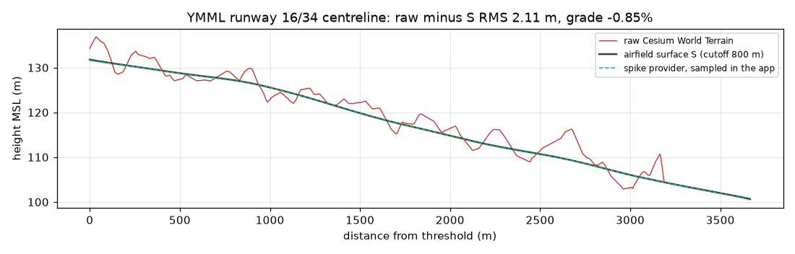

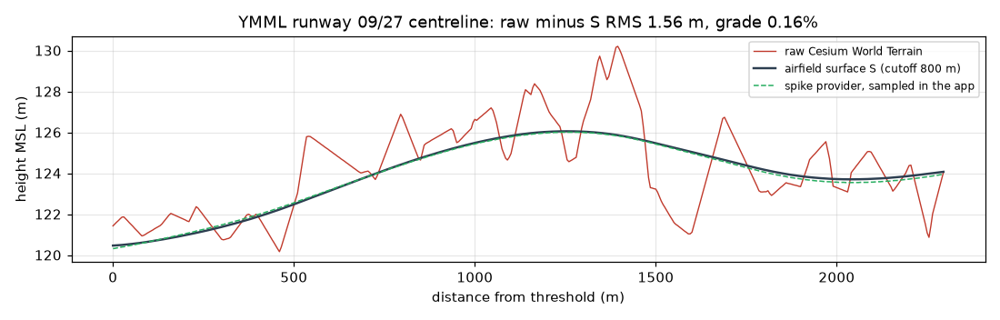

The same fit, offline, at the other bad-data fields and on a clean field that is left raw:

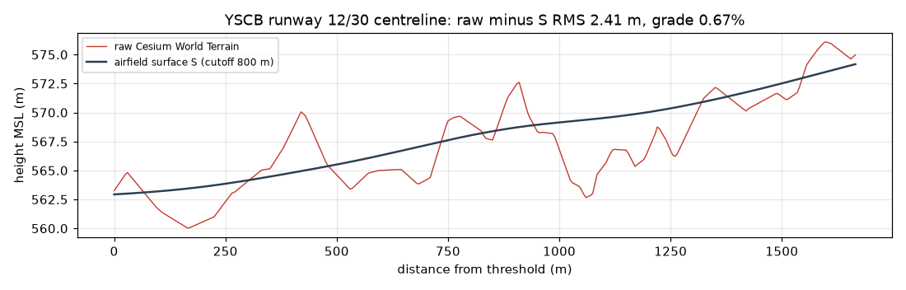

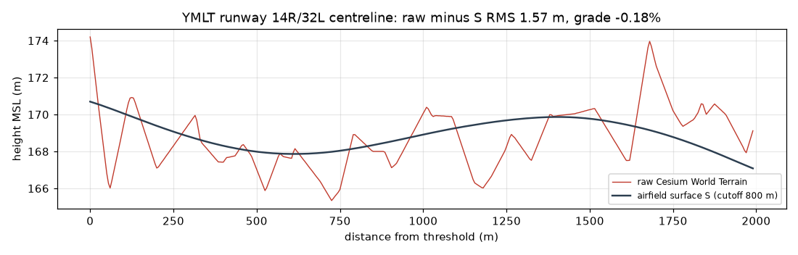

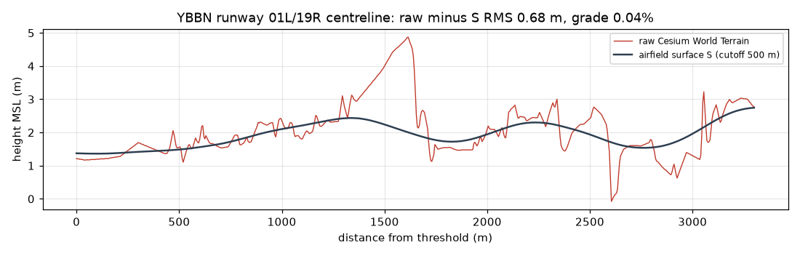

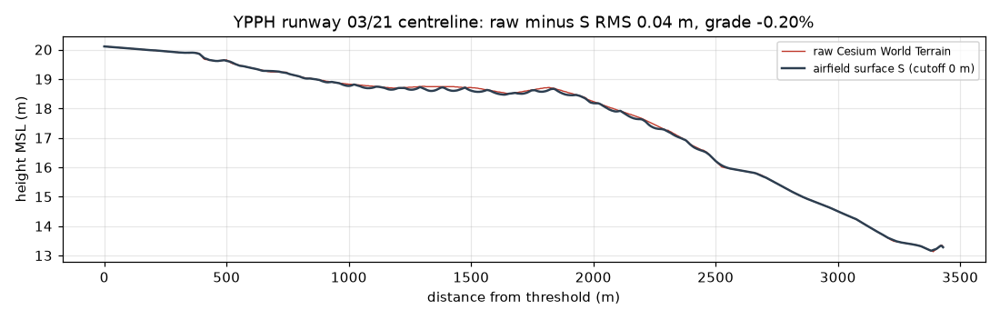

Airfield maps (raw, after blending, and raw minus S with the pavement outlined):

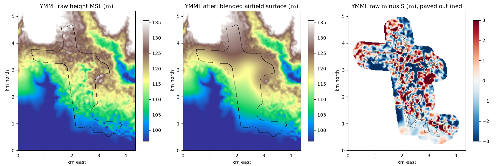

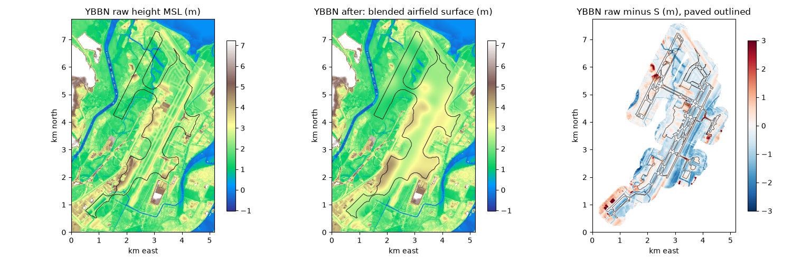

### Not covered by the spike

Worker offload, TIN rasterisation in place of `sampleTerrainMostDetailed`, the aircraft height path (`groundHeight`) wired into the app, captures at the other airports, iPad timing, and the camera re-placement noted in §4.3.
